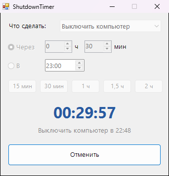

<div align="center">

# ⏻ ShutdownTimer

**Выключит, перезагрузит или усыпит компьютер через заданное время**




</div>

## ✨ Возможности

- ⏱️ Через N часов и минут или в точное время (например, в 02:00)
- 🎛️ Выключение, перезагрузка, сон, гибернация, блокировка или выход из системы
- ⚡ Быстрые кнопки: 15 минут, 30 минут, 1 час, 1,5 часа, 2 часа
- 🔔 За минуту до срабатывания предупредит уведомлением, так что можно успеть отменить
- 📥 Сворачивается в трей, оставшееся время видно при наведении на иконку
- 🛑 Не даст случайно закрыть окно с запущенным таймером

## 💡 Когда пригодится

- Засыпаешь под фильм или сериал
- Ставишь на ночь загрузку или рендер
- Хочешь, чтобы ребёнок не сидел за компьютером дольше положенного

## 📥 Установка

1. Скачай `ShutdownTimer.exe` из раздела [**Releases**](../../releases/latest)
2. Запусти его, установка не нужна

## 🛠️ Сборка из исходников

Нужен только Windows: компилятор C# входит в состав .NET Framework.

```bat
build.bat
```

## 📄 Лицензия

[MIT](LICENSE)
